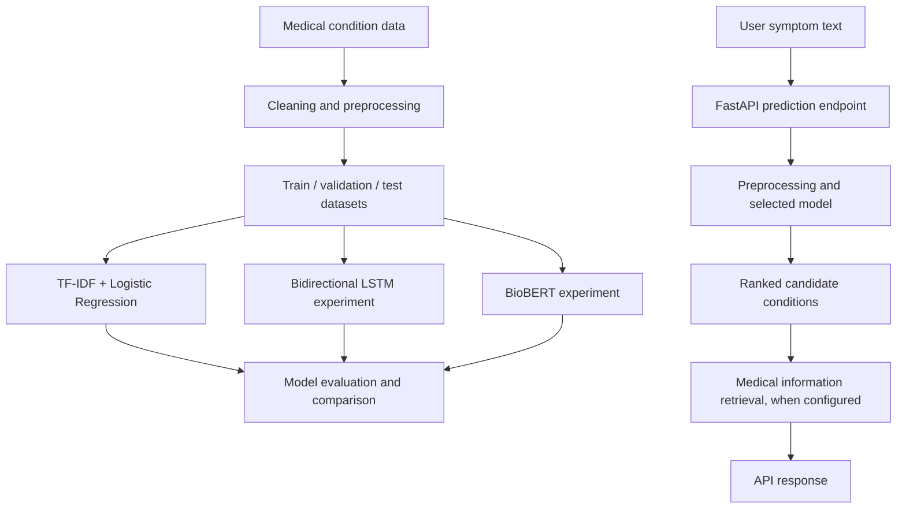

# Medical AI Disease Prediction

An experimental AI and NLP project that analyzes free-text symptom descriptions and ranks possible medical conditions using machine-learning and deep-learning models. The project also includes a FastAPI service and a medical-information retrieval workflow.

> **Medical disclaimer:** This project is for educational and research purposes only. It is not clinically validated and must not be used to diagnose, treat, or rule out any medical condition. Always consult a qualified healthcare professional.

## Overview

Medical AI Disease Prediction explores how natural language processing (NLP) can be used to map symptom descriptions to possible disease labels. The workflow includes medical-text preparation, model training and evaluation, ranked predictions, and retrieval of related medical information.

The project compares a traditional NLP baseline with an improved Logistic Regression model and experimental neural models. The experiments show why model evaluation is essential: a more complex neural architecture does not automatically perform better than a well-configured classical machine-learning pipeline.

## Key Features

- Medical-condition dataset preparation and text preprocessing.
- TF-IDF-based text representation for classical machine learning.
- Baseline and improved Logistic Regression experiments.
- Experimental Bidirectional LSTM and BioBERT model comparisons.
- Ranked Top-K disease predictions through the prediction pipeline.
- FastAPI endpoints for project information, health checks, and prediction.
- MongoDB integration for medical information retrieval, where configured.
- Automated tests using `pytest`.

Features and results should be interpreted in the context of this experimental project; they do not establish clinical accuracy or safety.

## Architecture

The high-level flow below summarizes the implemented prediction workflow. Model families are evaluated as separate experiments; they should not be interpreted as an ensemble unless the code explicitly combines them.



## Technology Stack

| Technology | Purpose |
|---|---|
| Python | Main development language |
| Pandas and NumPy | Data preparation and numerical operations |
| scikit-learn | TF-IDF, Logistic Regression, and evaluation |
| PyTorch | Deep-learning experiments, including BiLSTM |
| Hugging Face Transformers | Transformer model experiments, where configured |
| FastAPI | REST API |
| Uvicorn | Local ASGI server |
| MongoDB | Medical information storage and retrieval, when configured |
| pytest | Automated tests |
| Git and GitHub | Version control and project hosting |

## Dataset and Preprocessing

The project documentation records the following dataset-preparation figures:

- **429** medical conditions in the cleaned source dataset.
- **1,932** chunks in the prepared text collection.
- Approximately **865 characters** per chunk on average.
- Chunk lengths from **204 to 1,184 characters** in the documented dataset.

The project uses medical-condition text and prepares it for model training and inference. The exact preprocessing and splitting steps are defined by the source code and data artifacts in the repository.

## Model Evaluation

The following results are recorded in the project's evaluation guide. They should be kept aligned with the corresponding evaluation artifacts when the models or datasets are retrained.

| Model | Validation Accuracy | Test Accuracy | Test Weighted F1 | Test Macro F1 |
|---|---:|---:|---:|---:|
| Baseline | 85.04% | 82.60% | 80.39% | Not reported |
| Improved Logistic Regression | **86.86%** | **83.15%** | **80.70%** | **80.25%** |
| Bidirectional LSTM | 7.66% | 4.97% | 3.71% | 3.50% |
| BioBERT | 12.41% | 8.29% | 3.41% | 3.40% |

### Interpreting the results

- The documented Improved Logistic Regression experiment has the strongest reported results among these comparisons.
- The BiLSTM and BioBERT results are substantially weaker in the documented experiments and should be treated as experimental baselines requiring further investigation.
- Overall accuracy alone does not establish reliable performance for every disease class. Macro F1, class-level results, dataset coverage, calibration, and independent evaluation are important considerations.
- Any scores returned by the API are model outputs, not clinically meaningful or calibrated probabilities unless calibration has been explicitly implemented and validated.

## Project Structure

The repository may contain the following major components; consult the actual files in the checked-out version for the complete structure.

```text
Medical_AI_project/
├── api/             # FastAPI application and endpoint definitions
├── data/            # Training, validation, test, and prepared datasets
├── database/        # Database configuration and data-access logic
├── preprocessing/   # Text cleaning and dataset preparation
├── training/        # Model training and experiment code
├── prediction/      # Model loading and prediction logic
├── tests/           # Automated tests
├── models/          # Local model artifacts, if present
├── results/         # Evaluation outputs, if present
├── main.py          # Main entry point, if used
├── config.py        # Configuration, if present
├── requirements.txt # Python dependencies, if present
└── README.md
```

Large trained model artifacts may not be tracked in GitHub. Check the repository and its setup instructions for any required model files before running inference.

## Getting Started

### Prerequisites

- Windows PowerShell or another supported terminal.
- A compatible Python version for the project's dependencies.
- Git.
- MongoDB only if the selected application workflow requires database access.
- Model artifacts and any required environment configuration.

### 1. Clone the repository

```powershell
git clone https://github.com/adhamadelemam429-star/medical-ai-disease-prediction.git
cd medical-ai-disease-prediction
```

### 2. Create and activate a virtual environment

```powershell
python -m venv .venv
.\.venv\Scripts\Activate.ps1
```

If PowerShell prevents activation because of its execution policy, use your usual approved local Python environment workflow rather than changing system-wide security settings.

### 3. Install dependencies

If the repository contains `requirements.txt`, run:

```powershell
python -m pip install --upgrade pip
python -m pip install -r requirements.txt
```

Use the dependency manager and instructions included in the checked-out repository if it differs from this example.

### 4. Configure the environment

Review the project's configuration files and required environment variables. If MongoDB or other external services are required, configure them locally using your own credentials.

Do not commit `.env` files, passwords, API keys, or connection strings containing secrets. Use placeholder values in any example configuration file.

### 5. Start the API

The project documentation identifies the following local FastAPI startup command:

```powershell
python -m uvicorn api.app:app --host 127.0.0.1 --port 8000
```

Run it from the project root after installing dependencies and configuring the required resources. If the entry point or configuration has changed, follow the current source code.

When the server starts successfully, open:

- API root: `http://127.0.0.1:8000/`
- Interactive API documentation: `http://127.0.0.1:8000/docs`

## API Endpoints

The project documentation describes these endpoints. Confirm their current request and response schemas in `api/` before integrating another application.

| Method | Endpoint | Purpose |
|---|---|---|
| `GET` | `/` | Project or service information |
| `GET` | `/health` | Health check |
| `POST` | `/predict` | Submit symptom text and receive ranked candidate conditions |

### Example prediction request

```json
{
  "symptoms": "fever, cough, sore throat and fatigue",
  "top_k": 5
}
```

This example reflects the documented request shape. The exact response fields, validation rules, and error formats are defined by the current API implementation.

## Running Tests

From the project root, activate the intended virtual environment and run:

```powershell
python -m pytest -q
```

The project guide records a run with **5 tests passed**. Results can vary with code changes, dependency versions, configuration, and available local resources; run the command on your current checkout to confirm its status.

## Limitations and Responsible Use

- This is an educational and experimental project, not a clinical decision-support system.
- The model may return incorrect, incomplete, or misleading candidates.
- Performance may vary significantly across disease classes and symptom descriptions.
- The documented deep-learning experiments perform poorly and require further work.
- Prediction scores must not be interpreted as reliable medical probabilities without appropriate calibration and validation.
- The project has not been established as clinically validated or approved for medical use.
- Do not use the output to delay professional assessment or emergency care.
- Do not submit identifiable patient information unless the system has been appropriately reviewed and secured for that use.

## Future Improvements

- Improve dataset coverage, quality, and class balance.
- Investigate weak performance in the BiLSTM and BioBERT experiments.
- Add per-class precision, recall, confusion matrices, and robust Top-K evaluation.
- Assess model calibration and confidence reliability.
- Expand unit and integration tests, including API validation and failure cases.
- Improve observability, configuration validation, and reproducibility.
- Consider multilingual support and a user interface as future work, if needed.

## Author

**Adham Adel Imam**

- GitHub: [@adhamadelemam429-star](https://github.com/adhamadelemam429-star)
- Repository: [Medical AI Disease Prediction](https://github.com/adhamadelemam429-star/medical-ai-disease-prediction)

## License

No license is stated here. Check the repository for an existing `LICENSE` file before redistributing or reusing the project.
